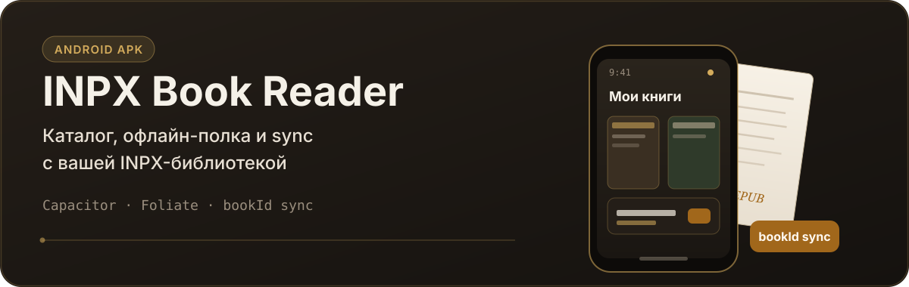
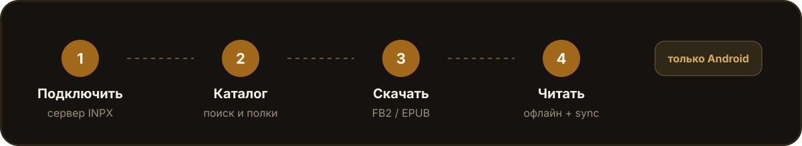
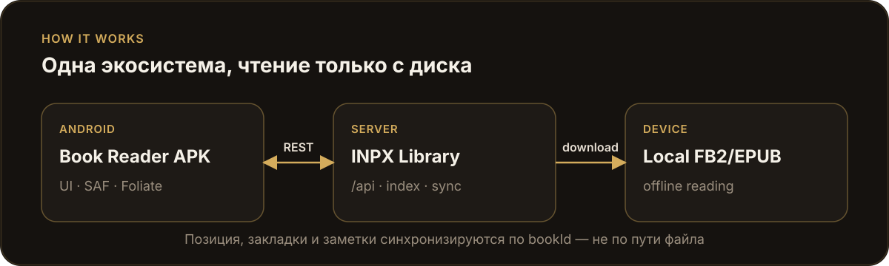

<p align="center">
  
</p>

<p align="center">
  <a href="https://github.com/Habsaec/inpx-book-reader/releases/latest"></a>
  
  <a href="https://github.com/Habsaec/inpx-library-server"></a>
</p>

<p align="center">
  <a href="#установка">Установка</a> ·
  <a href="#возможности">Возможности</a> ·
  <a href="#первый-запуск">Первый запуск</a> ·
  <a href="#сборка-из-исходников">Сборка</a> ·
  <a href="https://boosty.to/habsaec/donate">Поддержать проект</a>
</p>

# INPX Book Reader

Android-читалка для домашней библиотеки на [**INPX Library Server**](https://github.com/Habsaec/inpx-library-server). Каталог, поиск, полки и рекомендации приходят с сервера; книги скачиваются на телефон и читаются офлайн, а позиция, закладки и заметки синхронизируются с веб-читалкой и другими устройствами.

> Приложению нужен работающий INPX Library Server: без него нет каталога, скачивания и синхронизации. Уже скачанные книги и файлы с телефона читаются и без сервера.

<p align="center">
  
</p>

## Установка

1. Скачайте **APK** из [последнего релиза](https://github.com/Habsaec/inpx-book-reader/releases/latest) — или отсканируйте QR-код в боковой панели веб-интерфейса библиотеки.
2. Откройте файл на телефоне и разрешите установку из этого источника.
3. Новые версии приложение находит и ставит само: **Профиль → О приложении**.

Требуется Android 6.0 или новее. iOS, десктоп и PWA не поддерживаются.

## Возможности

### Библиотека

- Каталог с поиском, подсказками и фильтрами (жанр, язык, формат, год, рейтинг, серии, скрытие прочитанного)
- Авторы, серии и жанры; прогресс серии и кнопка «Читать следующую»
- Главная: «Продолжить чтение», новинки, рекомендации, «Новое у любимых», полки, закреплённые на сайте
- «Мои книги»: читаю, хочу прочитать, прочитано, мои оценки, избранное, полки и умные полки
- Цель на год и статистика чтения в профиле

### Чтение

- FB2, FB2.ZIP, EPUB — из скачанного файла, без сети
- Темы, шрифты, поля, межстрочный интервал, режим прокрутки или страниц, зоны касания
- Закладки и заметки с цветами — отдельные разделы со всеми записями
- Озвучка (TTS) с управлением из шторки и экрана блокировки
- Режим для E-Ink (Onyx BOOX, Hisense и др.): без анимаций, с управлением подсветкой жестом

### Синхронизация

- Позиция чтения, закладки, заметки и отметки «прочитано» — по `bookId`, общие с веб-читалкой
- Если книгу читают на другом устройстве, приложение спрашивает, где продолжить, а не «прыгает» молча
- Работа офлайн: изменения копятся и отправляются, когда сервер снова доступен

### Устройство

- Очередь загрузок с уведомлением; при занятом сервере загрузка ждёт и повторяет попытку
- Своя папка для книг (выбор через системный диалог), просмотр папок на телефоне
- Открытие FB2 / EPUB из файлового менеджера и других приложений
- Виджет «Продолжить чтение» на рабочем столе
- Цвета приложения: свой акцент или палитра сервера («Цвет: Сервер»)

## Первый запуск

Мастер настройки из трёх шагов:

1. **Сервер.** Самый простой путь — **«Сканировать QR»**: в веб-интерфейсе библиотеки откройте окно приложения в боковой панели и отсканируйте одноразовый код входа (действует 10 минут, пароль не передаётся). Или введите адрес вида `http://192.168.1.10:3000`, логин и пароль.
2. **Папка хранения** — куда скачивать книги; можно оставить предложенную.
3. **Готово** — каталог, скачивание, чтение.

Сменить сервер позже: **Профиль → Сервер**.

**Нет связи с сервером?**

- Указывайте IP компьютера или NAS в локальной сети, а не `localhost` / `127.0.0.1`.
- Телефон и сервер должны быть в одной сети (или сервер доступен снаружи).
- На Windows разрешите порт `3000` в брандмауэре.
- HTTP без HTTPS для домашней сети разрешён.

## Как устроено

<p align="center">
  
</p>

```text
Android APK  ←── REST /api/* ──→  INPX Library Server
     │
     └── скачивание → локальные FB2 / EPUB → Foliate (офлайн)
```

Метаданные (серия, автор, жанры) берутся только из индекса сервера, не из файла. Путь к файлу на телефоне — снимок на момент скачивания и не синхронизируется.

| Слой | Технология |
| --- | --- |
| UI | React 19 · TypeScript · Tailwind 4 · Capacitor 7 |
| Читалка | [Foliate](https://github.com/johnfactotum/foliate-js) в WebView, общий с веб-читалкой код позиции |
| Нативная часть | Хранилище книг (SAF), загрузки, TTS, виджет, QR, E-Ink, обновления |
| API | `src/lib/inpxClient.ts` → CapacitorHttp |

## Сборка из исходников

Нужны **Node.js 20+**, **Android Studio** (SDK API 35, Build-Tools, Platform-Tools) и **JDK 17**. Команды ниже — для Windows (`gradlew.bat`).

```powershell
git clone https://github.com/Habsaec/inpx-book-reader.git
cd inpx-book-reader
npm install
npm run build:android
```

Готовый файл: `android/app/build/outputs/apk/debug/app-debug.apk`.

```powershell
adb install android\app\build\outputs\apk\debug\app-debug.apk
```

Или откройте проект в Android Studio (`npm run android:open`) и соберите через **Build → Build APK(s)** / Run ▶. Подписанный релиз, переменные окружения и типичные ошибки — в [`docs/ANDROID.md`](./docs/ANDROID.md).

### Отладка в браузере

Браузер — только инструмент разработки, не целевая платформа. `server.ts` — прокси для localhost, в APK не используется.

```powershell
npm install
npm run dev
```

Откройте `http://localhost:3100` и подключитесь к серверу `http://127.0.0.1:3000`.

### Команды

```powershell
npm run lint              # tsc --noEmit
npm test                  # vitest
npm run build:app         # веб-сборка для Capacitor
npm run build:android     # build:app + cap sync + debug APK
npm run android:sync      # cap sync без пересборки веба
npm run android:open      # Android Studio
npm run verify:api-parity # сверка API с сервером
```

После изменений UI пересоберите (`build:android` или `build:app` + `android:sync`) и переустановите APK.

## Связанные проекты

| Репозиторий | Роль |
| --- | --- |
| [inpx-library-server](https://github.com/Habsaec/inpx-library-server) | Сервер: индекс INPX, веб, OPDS, API и синхронизация |
| [inpx-book-reader](https://github.com/Habsaec/inpx-book-reader) | Android-приложение (этот репозиторий) |

Контракт API и синхронизации для разработки — [`AGENTS.md`](./AGENTS.md).
