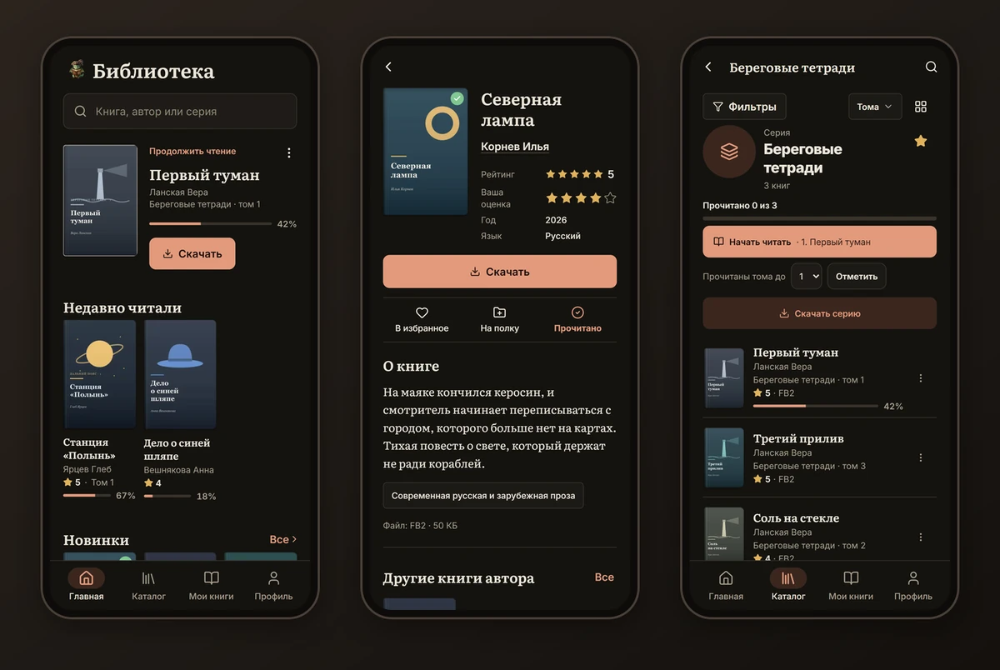
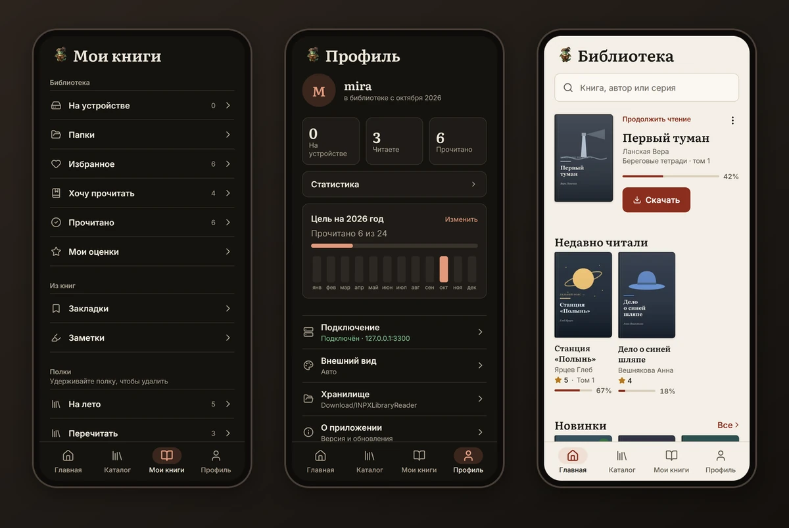
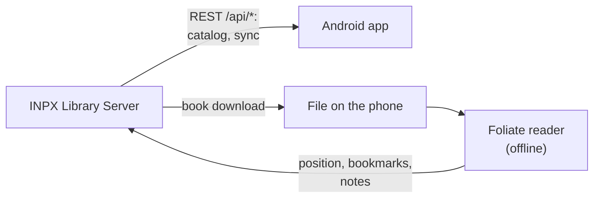

<h1 align="center">INPX Book Reader</h1>

<p align="center">
  <b>English</b> · <a href="README.ru.md">Русский</a>
</p>

<p align="center">
  Android reader for a home library running <a href="https://github.com/Habsaec/inpx-library-server">INPX Library Server</a>:<br>
  the catalog from the server, books offline on your phone, one reading position shared with the browser.
</p>

<p align="center">
  <a href="https://github.com/Habsaec/inpx-book-reader/releases/latest"></a>
  
  <a href="https://github.com/Habsaec/inpx-library-server"></a>
</p>

<p align="center">
  
</p>

<p align="center">
  <a href="#installation">Installation</a> ·
  <a href="#connecting-to-the-server">Connecting</a> ·
  <a href="#features">Features</a> ·
  <a href="#building-from-source">Building</a>
</p>

<p align="center">
  <a href="https://boosty.to/habsaec/donate"></a>
</p>

> [!IMPORTANT]
> The app works together with [INPX Library Server](https://github.com/Habsaec/inpx-library-server): the catalog, books and sync come from it. Install the server first. Books already downloaded and files from the phone can be read without it.

> [!NOTE]
> The app interface is currently in **Russian only**. Menu names below are given in Russian with an English translation. The server's web interface is available in English.

## Installation

1. Download `INPX.Book.Reader.<version>.apk` from the [latest release](https://github.com/Habsaec/inpx-book-reader/releases/latest). On a phone it is easier to scan the «App» QR code in the sidebar of the library's web interface.
2. Open the file and allow installing from this source.
3. After that the app updates itself: **Профиль → О приложении** (Profile → About).

Requires Android 6.0 or newer. iOS and desktop are not supported.

## Connecting to the server

On first launch a setup wizard walks you through three steps.

1. **Sign in.** The easiest way is a QR code: in the library's web interface, press «App» in the sidebar and scan the one-time sign-in code (valid for 10 minutes, the password is not transferred). Or tap «Войти по логину и паролю» (sign in with login and password) and enter the server address, e.g. `http://192.168.1.10:3000`, your login and password.
2. **Books folder** — where downloads are saved; you can keep the suggested one.
3. **Done** — catalog, downloads, reading.

To change the server later: **Профиль → Подключение** (Profile → Connection).

<details>
<summary><b>Can't connect?</b></summary>

- The server address is the IP of the computer or NAS on your local network, not `localhost` / `127.0.0.1`.
- The phone and the server are on the same network (or the server is reachable from outside).
- On Windows, allow incoming connections on port `3000` in the firewall.
- Plain HTTP without HTTPS is allowed on a home network.

</details>

## Features

<p align="center">
  
</p>

**Library.** Catalog with search and filters (genre, language, format, year, rating, hide finished books). Authors, series, genres; a series shows «N of M read» and «Read next». The home screen has continue reading, new arrivals, recommendations, «New from favorites» and shelves pinned on the website.

**My books.** Reading, want to read, finished, ratings, favorites, shelves and smart shelves, all bookmarks and notes. Yearly goal and stats in the profile.

**Reading.** FB2, FB2.ZIP and EPUB from the downloaded file, no network needed. Themes, fonts, margins, line spacing, pages or scrolling, configurable tap zones. Bookmarks and color-coded notes. Read aloud (TTS): a player with paragraph and sentence navigation, speed, pitch, sleep timer, sentence and word highlighting; controls in the notification shade and on the lock screen.

**Sync.** Position, bookmarks, notes and «finished» marks are shared with the web reader and other devices. If the book is being read elsewhere, the app asks where to continue — no silent «jumps». Offline changes are queued and sent to the server later.

**Device.** Download queue with a notification. Your own books folder and browsing the phone's folders. Opening FB2 / EPUB from a file manager. «Continue reading» widget. E-Ink mode (Onyx BOOX, Hisense and others) with a frontlight gesture. App colors — your own or the server's palette.

## How it works



Metadata (author, series, genres) comes only from the server's index, not from the file. Position and notes are tied to the book's `bookId` on the server, so they match in the app and in the browser.

| Layer | Technology |
| --- | --- |
| Interface | React 19 · TypeScript · Tailwind 4 · Capacitor 7 |
| Reader | [foliate-js](https://github.com/johnfactotum/foliate-js) in a WebView, position code shared with the web reader |
| Native side | Book storage (SAF), downloads, TTS, widget, QR, E-Ink, updates |
| API | `src/lib/inpxClient.ts` → CapacitorHttp |

## Building from source

You need **Node.js 20+**, **Android Studio** (Android SDK 35, Build-Tools, Platform-Tools) and **JDK 17**. The commands are for Windows.

```powershell
git clone https://github.com/Habsaec/inpx-book-reader.git
cd inpx-book-reader
npm install
npm run build:android
```

The APK appears in `android\app\build\outputs\apk\debug\app-debug.apk`:

```powershell
adb install android\app\build\outputs\apk\debug\app-debug.apk
```

Or open the project in Android Studio (`npm run android:open`) and run ▶ on a device. Signed release builds and common build errors are covered in [`docs/ANDROID.md`](./docs/ANDROID.md) (in Russian).

<details>
<summary><b>Debugging in the browser</b></summary>

The browser is a development tool only. `server.ts` proxies requests to the library server; it is not used in the APK.

```powershell
npm run dev
```

Open http://localhost:3100 and connect to the server (e.g. `http://127.0.0.1:3000`).

</details>

<details>
<summary><b>Commands</b></summary>

```powershell
npm run lint              # tsc --noEmit
npm test                  # vitest
npm run build:app         # web build for Capacitor
npm run build:android     # build:app + cap sync + debug APK
npm run android:sync      # cap sync without rebuilding the web part
npm run android:open      # Android Studio
npm run verify:api-parity # check the API against the server
```

</details>

## Related projects

| Repository | |
| --- | --- |
| [inpx-library-server](https://github.com/Habsaec/inpx-library-server) | Server: INPX index, web, OPDS, API and sync |
| [inpx-book-reader](https://github.com/Habsaec/inpx-book-reader) | Android app (this repository) |

API and sync contract — [`AGENTS.md`](./AGENTS.md). The screenshots show a fictional demo library.
