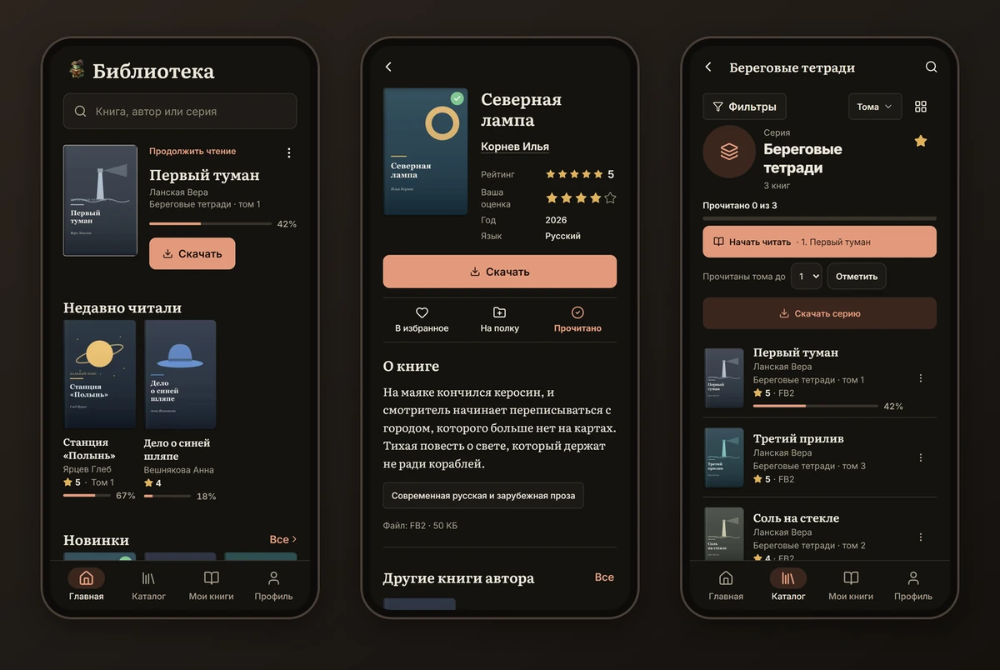
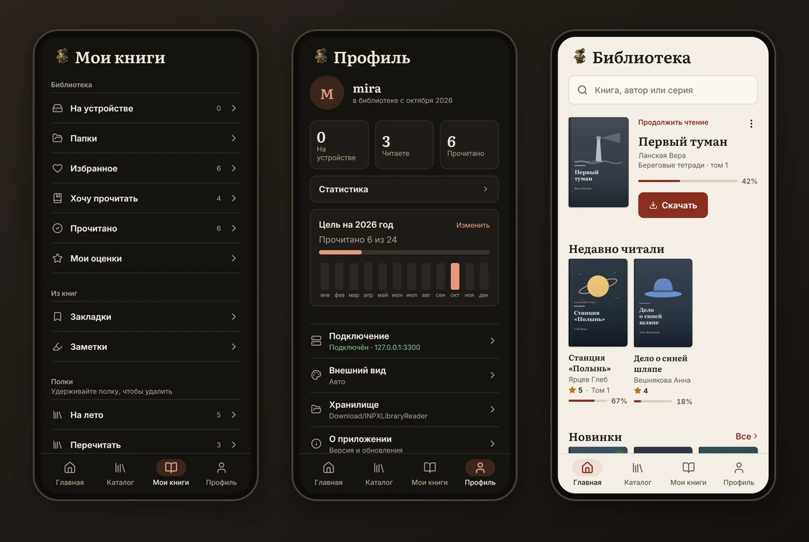
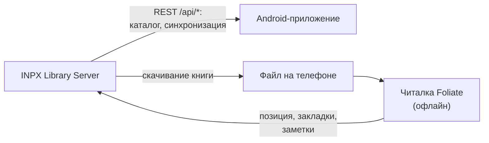

<h1 align="center">INPX Book Reader</h1>

<p align="center">
  Android-читалка для домашней библиотеки на <a href="https://github.com/Habsaec/inpx-library-server">INPX Library Server</a>:<br>
  каталог с сервера, книги офлайн на телефоне, общая с браузером позиция чтения.
</p>

<p align="center">
  <a href="https://github.com/Habsaec/inpx-book-reader/releases/latest"></a>
  
  <a href="https://github.com/Habsaec/inpx-library-server"></a>
</p>

<p align="center">
  
</p>

<p align="center">
  <a href="#установка">Установка</a> ·
  <a href="#подключение-к-серверу">Подключение</a> ·
  <a href="#возможности">Возможности</a> ·
  <a href="#сборка-из-исходников">Сборка</a> ·
  <a href="https://boosty.to/habsaec/donate">Поддержать проект</a>
</p>

> [!IMPORTANT]
> Приложение работает вместе с [INPX Library Server](https://github.com/Habsaec/inpx-library-server): с него приходят каталог, книги и синхронизация. Сначала установите сервер. Уже скачанные книги и файлы с телефона читаются и без него.

## Установка

1. Скачайте `INPX.Book.Reader.<версия>.apk` из [последнего релиза](https://github.com/Habsaec/inpx-book-reader/releases/latest). С телефона удобнее отсканировать QR-код «Приложение» в боковой панели веб-интерфейса библиотеки.
2. Откройте файл и разрешите установку из этого источника.
3. Дальше приложение обновляется само: **Профиль → О приложении**.

Нужен Android 6.0 или новее. iOS и десктоп не поддерживаются.

## Подключение к серверу

При первом запуске мастер проведёт через три шага.

1. **Вход.** Проще всего по QR-коду: в веб-интерфейсе библиотеки нажмите «Приложение» в боковой панели и отсканируйте одноразовый код входа (действует 10 минут, пароль не передаётся). Или нажмите «Войти по логину и паролю» и введите адрес сервера, например `http://192.168.1.10:3000`, логин и пароль.
2. **Папка для книг** — куда сохранять скачанное; можно оставить предложенную.
3. **Готово** — каталог, скачивание, чтение.

Сменить сервер позже: **Профиль → Подключение**.

<details>
<summary><b>Не подключается?</b></summary>

- Адрес сервера — IP компьютера или NAS в локальной сети, а не `localhost` / `127.0.0.1`.
- Телефон и сервер в одной сети (или сервер доступен снаружи).
- На Windows разрешите входящие подключения на порт `3000` в брандмауэре.
- HTTP без HTTPS в домашней сети разрешён.

</details>

## Возможности

<p align="center">
  
</p>

**Библиотека.** Каталог с поиском и фильтрами (жанр, язык, формат, год, рейтинг, скрытие прочитанного). Авторы, серии, жанры; у серии — «Прочитано N из M» и «Читать следующую». На главной «Продолжить чтение», новинки, рекомендации, «Новое у любимых» и полки, закреплённые на сайте.

**Мои книги.** Читаю, хочу прочитать, прочитано, оценки, избранное, полки и умные полки, все закладки и заметки. Цель на год и статистика в профиле.

**Чтение.** FB2, FB2.ZIP и EPUB из скачанного файла, без сети. Темы, шрифты, поля, интервалы, страницы или прокрутка, настраиваемые зоны касания. Закладки и цветные заметки. Озвучка (TTS): плеер с абзацами и фразами, скоростью, тоном, таймером сна, подсветкой фразы и слова; управление из шторки и с экрана блокировки.

**Синхронизация.** Позиция, закладки, заметки и отметки «прочитано» общие с веб-читалкой и другими устройствами. Если книгу читают в другом месте, приложение спрашивает, где продолжить, — без молчаливых «прыжков». Без сети изменения копятся и уходят на сервер позже.

**Устройство.** Очередь загрузок с уведомлением. Своя папка для книг и просмотр папок телефона. Открытие FB2 / EPUB из файлового менеджера. Виджет «Продолжить чтение». Режим E-Ink (Onyx BOOX, Hisense и др.) с регулировкой подсветки жестом. Цвета приложения — свои или из палитры сервера.

## Как устроено



Метаданные (автор, серия, жанры) берутся только из индекса сервера, а не из файла. Позиция и заметки привязаны к `bookId` книги на сервере, поэтому совпадают в приложении и в браузере.

| Слой | Технология |
| --- | --- |
| Интерфейс | React 19 · TypeScript · Tailwind 4 · Capacitor 7 |
| Читалка | [foliate-js](https://github.com/johnfactotum/foliate-js) в WebView, общий с веб-читалкой код позиции |
| Нативная часть | Хранилище книг (SAF), загрузки, TTS, виджет, QR, E-Ink, обновления |
| API | `src/lib/inpxClient.ts` → CapacitorHttp |

## Сборка из исходников

Нужны **Node.js 20+**, **Android Studio** (Android SDK 35, Build-Tools, Platform-Tools) и **JDK 17**. Команды — для Windows.

```powershell
git clone https://github.com/Habsaec/inpx-book-reader.git
cd inpx-book-reader
npm install
npm run build:android
```

APK появится в `android\app\build\outputs\apk\debug\app-debug.apk`:

```powershell
adb install android\app\build\outputs\apk\debug\app-debug.apk
```

Или откройте проект в Android Studio (`npm run android:open`) и запустите ▶ на устройстве. Подписанный релиз и типичные ошибки сборки — в [`docs/ANDROID.md`](./docs/ANDROID.md).

<details>
<summary><b>Отладка в браузере</b></summary>

Браузер — только инструмент разработки. `server.ts` проксирует запросы к серверу библиотеки; в APK он не используется.

```powershell
npm run dev
```

Откройте http://localhost:3100 и подключитесь к серверу (например `http://127.0.0.1:3000`).

</details>

<details>
<summary><b>Команды</b></summary>

```powershell
npm run lint              # tsc --noEmit
npm test                  # vitest
npm run build:app         # веб-сборка для Capacitor
npm run build:android     # build:app + cap sync + debug APK
npm run android:sync      # cap sync без пересборки веба
npm run android:open      # Android Studio
npm run verify:api-parity # сверка API с сервером
```

</details>

## Связанные проекты

| Репозиторий | |
| --- | --- |
| [inpx-library-server](https://github.com/Habsaec/inpx-library-server) | Сервер: индекс INPX, веб, OPDS, API и синхронизация |
| [inpx-book-reader](https://github.com/Habsaec/inpx-book-reader) | Android-приложение (этот репозиторий) |

Контракт API и синхронизации — [`AGENTS.md`](./AGENTS.md). На скриншотах — вымышленная демо-библиотека.
